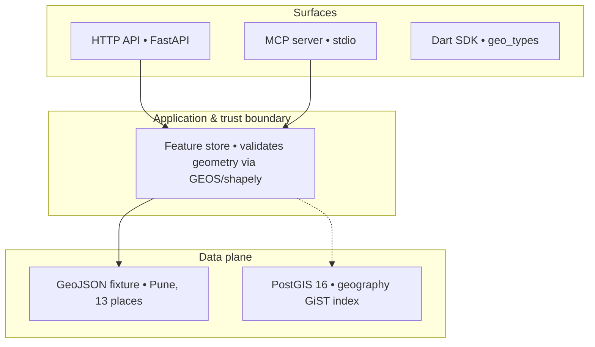

# OpenGeo

## Mission

OpenGeo is built for one belief: **geographic answers should never be guessed.** Every coordinate is EPSG:4326, longitude first. Every distance carries an explicit unit and method. Every geometry is validated before it is used — never silently repaired, never approximated. One spatial engine powers every surface, so an answer from the HTTP API is identical to an answer from the MCP server or the Dart SDK.

This is a toolkit for teams that need deterministic geography: a spatial engine you can trust, surfaces that agree with each other, and a refusal to pretend a straight line is a road trip.

## Major capabilities

**One engine, every surface.**  
A single validation boundary (GEOS/shapely) and one geodesy path feed every client surface. The HTTP API, the stdio MCP server, and the Dart SDK all read from the same trust boundary, so no two clients ever get contradictory answers for the same input.

**Deterministic, versioned data.**  
Every dataset carries a version derived from its source checksum. Serve Pune from 14 November, compare two versions side by side, roll back atomically if an import is bad. The database enforces one active version per region — Pune and Bengaluru never collide.

**Refusals, not approximations.**  
Routing, geocoding, and tiles are absent rather than stubbed with a straight line. `GET /v1/capabilities` tells clients exactly what this deployment refuses, so nothing is built on a capability that isn't really there.

**Bad data is stopped at the gate.**  
The ingestion gate validates every feature in an OSM extract — geometry, metadata, duplicate IDs, coordinate range — and refuses anything above a 20 % rejection ratio. Nothing is repaired silently.

**Honest errors.**  
Every rejection carries a machine-readable code (`invalid_ring`, `self_intersecting_ring`, `invalid_coordinate`) alongside a human message. Clients branch on the code, never on fragile message text.

**Cross-surface parity.**  
The Python service and the Dart SDK validate the same shared geometry verdicts. A validation rule that drifts on one surface fails the other.

## What you can build with OpenGeo

### Nearby POI search

Find businesses, services, or points of interest within a radius of any position, ordered by distance. A delivery app shows the nearest cafés to a user in Shivajinagar; a logistics dashboard lists warehouses within 5 km of a depot. Results carry exact metres — no guessing at proximity.

### Straight-line distance

Compute geodesic distance between two positions with an explicit unit and method. A travel planner shows the crow-flies distance from Cafe Goodluck to Pune Junction in kilometres. The method is declared on every answer, so a straight line is never mistaken for road distance.

### Point-in-region check

Test whether an address or GPS point falls inside a named region — for example, whether a delivery address is inside the Pune municipal boundary. Two predicates are available: `contains` excludes the boundary, `covers` includes it, so clients choose the exact semantics their business rule needs.

### Line-region intersection

Determine whether a route, delivery path, or drawn line crosses a region boundary. A fleet manager checks if a vehicle's planned route passes through a restricted zone before dispatching.

### Dataset versioning

Every dataset has a versioned identifier derived from its source checksum. Serve the Pune extract from a specific date, compare two versions side by side, and roll back to the previous one atomically if a new import is bad.

### Multi-region rollout

Run Pune as the first region, then add Bengaluru and other Indian metros without cross-contamination. The database enforces one active dataset version per region — activating a new extract for Bengaluru never displaces Pune's live data.

### Agent tool access

Expose spatial tools to AI agents over stdio via the MCP server. An agent can call `geo.nearby`, `geo.distance`, `geo.contains`, or `geo.intersects` and receive structured results — only the tools this build can actually serve, with nothing stubbed or approximated.

### Extract ingestion gate

Validate every feature in an OSM extract before it reaches production. The gate checks geometry validity, required metadata, duplicate IDs, and coordinate range, then refuses any file where more than 20 % of records fail. Nothing is repaired silently.

### Atomic publication

Dataset publication happens in a single transaction: stage an import run, validate it, publish it, and activate the new version. Either everything commits or nothing does — a failed run never leaves a partial dataset in place.

### Indian metros roadmap

Start with Pune as the first release, then extend to Bengaluru and other Indian metropolitan cities. Each region gets its own active dataset version, and no region's data is touched when another is updated.

## Architecture

## License

Code: Apache-2.0. OSM-derived data stays under ODbL and remains separate from the code; attribution remains visible in every client.
