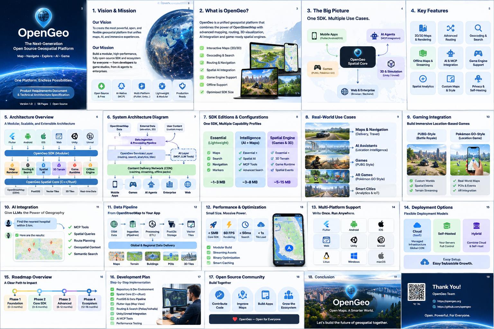
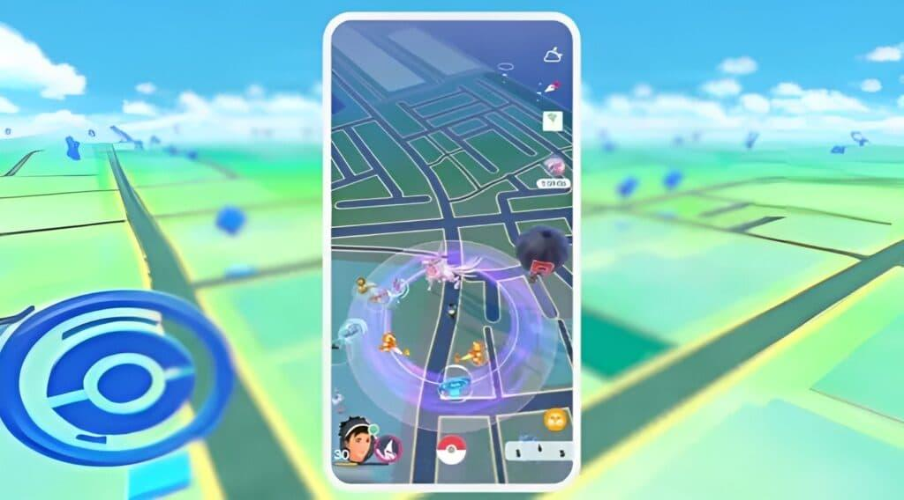
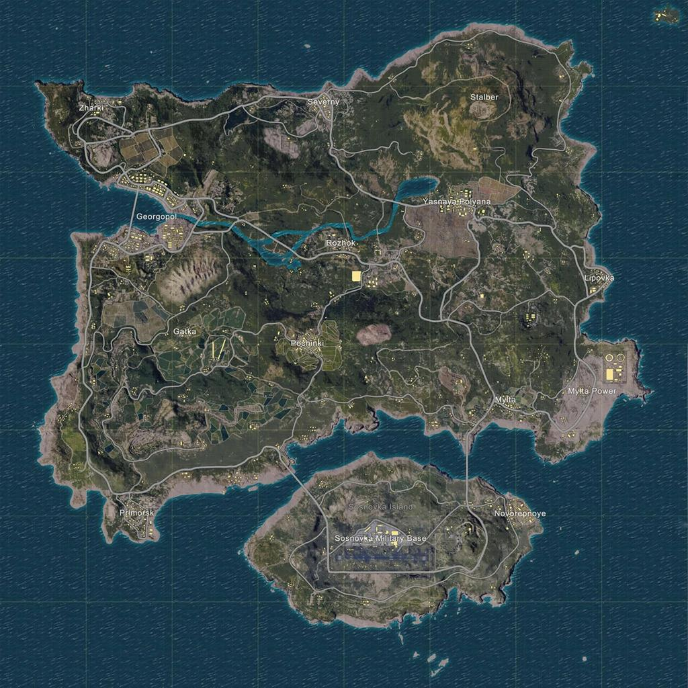
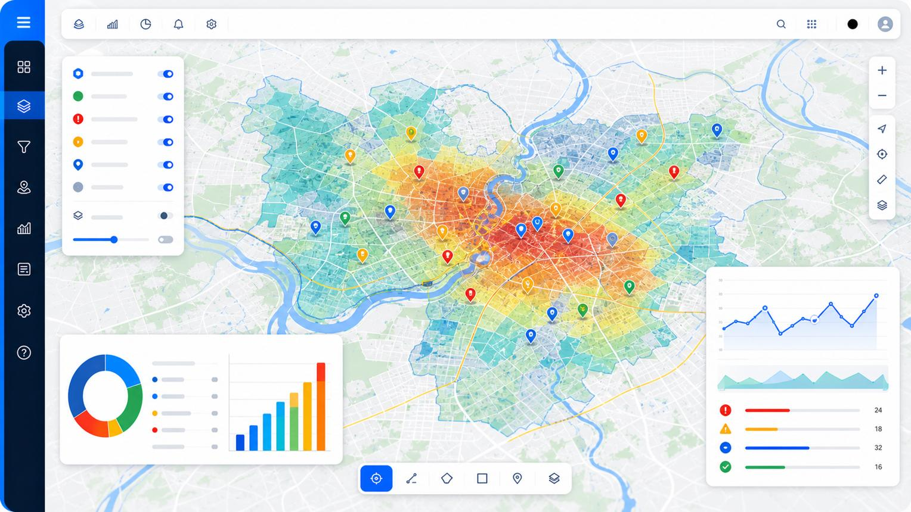
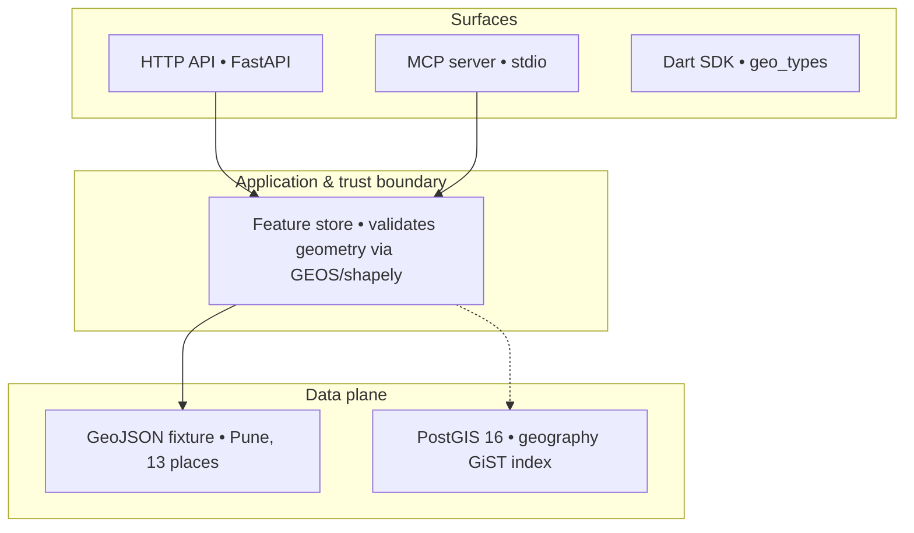

# OpenGeo



## Mission

Build the spatial engine that every app, agent, and game can trust — one deterministic geography implementation, self-hosted, with no approximations and no hidden stubs. OpenGeo exists so you never have to wonder whether a distance is road or straight-line, whether a point is inside or on the edge of a region, or whether the dataset behind an answer is the one you think it is.

## Major

- **One geography implementation.** Validation, geodesy, and predicates live in a single trust boundary. The HTTP API, MCP server, and Dart SDK all call the same code — an answer cannot differ between REST and MCP.
- **Refusals, not approximations.** Routing, geocoding, and isochrones are absent rather than stubbed with a straight line. `GET /v1/capabilities` tells clients exactly what this deployment can and cannot do.
- **Geometry that is rejected, never repaired.** Bad rings, swapped coordinates, self-intersections, and holes outside shells fail with stable error codes — never silently clamped into production bugs.
- **Dataset versions that cannot lie.** Every extract is checksum-verified, gated at a 20 % rejection ratio, and published atomically. One active version per region is enforced by the database, not by convention.
- **Four Indian metros in scope.** Pune first, then Bengaluru and other metros — each region isolated with its own active version, cross-contamination impossible.

## What OpenGeo does

Coordinates are **EPSG:4326, longitude first**. Distances carry an explicit **unit and method**. Bad geometry is rejected with a **stable error code** — never silently repaired. One geography implementation powers every surface (HTTP API, MCP server, Dart SDK), so an answer cannot differ between REST and MCP.

## Use cases

### Nearby POI search

Find businesses, services, or points of interest within a radius of any position, ordered by distance. A delivery app can show the nearest cafés to a user in Shivajinagar; a logistics dashboard can list warehouses within 5 km of a depot. Results carry exact metres so clients never guess at proximity.

### Straight-line distance

Compute geodesic distance between two positions with an explicit unit and method. A travel planner can show the crow-flies distance from Cafe Goodluck to Pune Junction in kilometres. The method is declared on every answer, so a straight line is never mistaken for road distance.

### Point-in-region check

Test whether an address or GPS point falls inside a named region — for example, whether a delivery address is inside the Pune municipal boundary. Two predicates are available: `contains` excludes the boundary, `covers` includes it, so clients choose the exact semantics their business rule needs.

### Line-region intersection

Determine whether a route, delivery path, or drawn line crosses a region boundary. A fleet manager can check if a vehicle's planned route passes through a restricted zone before dispatching.

### Dataset versioning

Every dataset has a versioned identifier derived from its source checksum. A client can serve the Pune extract from a specific date, compare two versions side by side, and roll back to the previous one atomically if a new import is bad.

### Boundary-in vs boundary-on

Two distinct predicates handle edge cases deliberately: `contains` excludes the boundary (a point exactly on the line returns false), `covers` includes it (returns true). Clients select the rule that matches their legal or operational definition of "inside."

### Multi-region rollout

Run Pune as the first region, then add Bengaluru and other Indian metros without cross-contamination. The database enforces one active dataset version per region, so activating a new extract for Bengaluru never displaces Pune's live data.

### Agent tool access

Expose spatial tools to AI agents over stdio via the MCP server. An agent can call `geo.nearby`, `geo.distance`, `geo.contains`, or `geo.intersects` and receive structured results — only the tools this build can actually serve, with nothing stubbed or approximated.

### Extract ingestion gate

Validate every feature in an OSM extract before it reaches production. The gate checks geometry validity, required metadata, duplicate IDs, and coordinate range, then refuses any file where more than 20 % of records fail. Nothing is repaired silently.

### Stable error codes

Every rejection carries a machine-readable code (`invalid_ring`, `self_intersecting_ring`, `invalid_coordinate`, etc.) alongside a human message. Clients branch on the code, never on fragile message text, so error handling is stable across versions.

### Capability manifest

`GET /v1/capabilities` reports what this deployment can and cannot do. `postgis`, `geocoding`, `routing`, and `tiles` are marked `unavailable` rather than implied, so clients never build on a capability that isn't actually there.

### Latency baseline

`benchmarks/run_baseline.py` records p50/p95/p99 latency for nearby scans and distance queries, annotated with commit hash, dataset version, dependency versions, and hardware. A number without that context is not a benchmark.

### Cross-surface parity

The Python service and the Dart SDK validate the same shared geometry verdicts (`tests/parity/geometry_vectors.json`). A validation rule that drifts on one surface fails the other, so an answer is consistent whether it comes from REST or Dart.

### PostGIS authority

When a database is attached, PostGIS becomes the served authority. The migration creates the PostGIS extension, a GiST index on geography, and enforces one active dataset version per region — application code never bypasses it.

### Atomic publication

Dataset publication happens in a single transaction: stage an import run, validate it, publish it, and activate the new version. Either everything commits or nothing does — a failed run never leaves a partial dataset in place.

### Indian metros roadmap

Start with Pune as the first release, then extend to Bengaluru and other Indian metropolitan cities. Each region gets its own active dataset version, and no region's data is touched when another is updated.

## Navigation modes

OpenGeo supports multiple map rendering and navigation modes. Each mode serves a different use case — from live street-level navigation to satellite imagery, LLM-powered natural-language queries, and game-style rendering.

| Mode | Description | Best for |
|------|-------------|----------|
| Live Realtime | Live street-level map with real-time traffic, POI search, and turn-by-turn navigation | Daily navigation, delivery tracking, ride-hailing |
| Satellite | High-resolution satellite imagery with terrain overlay | Field surveying, agriculture, disaster response |
| LLM based | Natural-language queries via LLM ("find cafes near me with WiFi") | Voice assistants, accessibility, exploratory search |
| Game maps | Stylized, game-engine rendering with custom themes | Games, simulations, AR experiences |






Each mode is available through the same `opengeo-mcp` tool suite and Dart SDK — the underlying geography engine never changes, only the rendering and interaction layer.

## Flutter client

The `sdk/flutter_client/` directory contains a complete example Flutter app demonstrating all navigation modes. It serves as both documentation and a reference implementation:

- **Maps screen**: Displays nearby places with placeholder for MapLibre GL integration
- **Navigation mode selection**: Four mode cards for Live Realtime, Satellite, LLM Based, Game Maps  
- **Place detail screen**: Shows place information with explicit EPSG:4326 coordinates
- **Design tokens**: Light/dark theme, 8-point spacing grid, teal primary color
- **Tests**: 9 passing unit tests for Place and NavigationMode models

```bash
cd sdk/flutter_client
flutter pub get
flutter test
```

### Architecture

The Flutter client follows Material 3 and follows the kill-the-vibecode-mobile principles:

- Material 3 design tokens (color, type, spacing, shape, motion)
- Safe areas respected on all devices
- 48dp minimum touch targets
- Light + dark theme support
- No gradient app bars, emoji, or invented ratings

### Real data integration

The app currently uses synthetic fixture data from `data/fixtures/pune_places.geojson`. Replace with live API calls by injecting `OpenGeoHttpClient` that hits your running OpenGeo instance.

## Architecture



