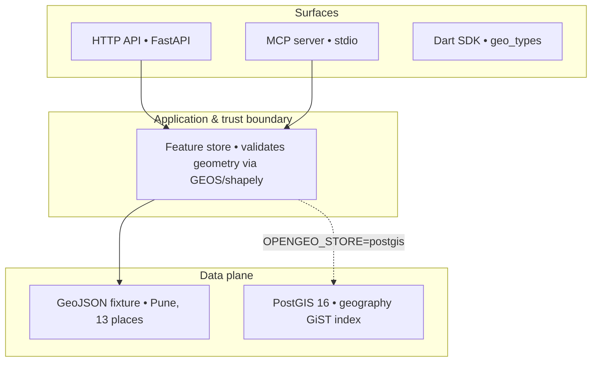

# OpenGeo

[](https://github.com/mr-vishwet/OpenGeo/actions)
[](LICENSE)
[](https://python.org)
[](https://dart.dev)
[](DATA_SOURCES.md)

> **OpenGeo** is a modular, self-hostable geospatial platform: one spatial engine, multiple rendering environments, on-demand geographic data, and modular capabilities for apps, agents and games.

Coordinates are **EPSG:4326, longitude first**. Distances carry an explicit **unit and method**. Bad geometry is rejected with a **stable error code** — never silently repaired. One geography implementation powers every surface (HTTP API, MCP server, Dart SDK), so an answer cannot differ between REST and MCP.

## What OpenGeo is

A single source of truth for geographic data in your infrastructure:

- **One spatial engine** — validation, geodesy and predicates live once, shared by every client surface.
- **Multiple surfaces** — a FastAPI HTTP API, a stdio MCP server for AI agents, and a dependency-free Dart SDK.
- **Deterministic by design** — every answer carries a dataset version and request id; two answers with different versions are not comparable.
- **Refusals, not approximations** — routing, geocoding and isochrones are absent rather than stubbed with a straight line.
- **Self-hostable** — PostGIS-backed with atomic dataset publication, rollback, and a 20 % rejection gate on imports.

## Architecture



| Layer | Responsibility |
|---|---|
| **Surfaces** | HTTP routes, MCP tools, Dart value types — thin, no geography logic |
| **Application** | One `FeatureStore` seam; validation boundary rejects bad input before any predicate |
| **Data plane** | GeoJSON fixture today; PostGIS 16 with a geography GiST index when attached |

## Capability matrix

| Surface | Capability | State |
|---|---|---|
| HTTP API (`opengeo-api`) | `/healthz`, `/readyz`, `/v1/capabilities`, `/v1/datasets`, `/v1/places/{id}`, `/v1/nearby`, `/v1/spatial/{distance,contains,intersects}` | Live |
| MCP server (`opengeo-mcp`) | `geo.nearby`, `geo.distance`, `geo.contains`, `geo.intersects` over stdio | Live |
| Dart SDK (`packages/geo_types`) | `Coordinate`, `Crs`, `BoundingBox`, `Distance`, 7 GeoJSON geometry types | Live |
| Ingestion gate (`opengeo-ingest`) | Checksum verify, import runs, atomic publish + rollback, 20 % rejection gate | Live |
| PostGIS | `0001_init.sql` schema, one active version per region, GiST index | Live on dev host |

`GET /v1/capabilities` is the authority on what works — `implemented` means exercised by the test suite; `unavailable` means refused, never approximated.

## What you can build with OpenGeo

Sixteen use cases the platform is designed to serve. The grid below is a **reference layout** — replace each placeholder with a real screenshot once the MapLibre/Flutter client and the regional Pune extract are in place.

| | | | |
|---|---|---|---|
| 📍 **1. Nearby POI search**<br>“What cafés are within 2 km of Shivajinagar?” | 📏 **2. Straight-line distance**<br>“How far is Cafe Goodluck from Pune Junction?” | 🏠 **3. Point-in-region check**<br>“Is this address inside the Pune municipal boundary?” | 🔗 **4. Line-region intersection**<br>“Does this delivery route cross the restricted zone?” |
| 🗺️ **5. Dataset versioning**<br>“Serve the Pune extract from 14 Nov; roll back if bad.” | ✅ **6. Boundary-in vs boundary-on**<br>“`contains` excludes the edge; `covers` includes it.” | 🧩 **7. Multi-region rollout**<br>“Pune first, then Bengaluru — one active version per region.” | 🤖 **8. Agent tool access**<br>“MCP server lets an AI agent call `geo.nearby` over stdio.” |
| 📥 **9. Extract ingestion gate**<br>“Reject an OSM extract if >20 % of features fail validation.” | 🔐 **10. Stable error codes**<br>“`invalid_ring` vs `self_intersecting_ring` — branch on code, not message.” | 📊 **11. Capability manifest**<br>“`GET /v1/capabilities` tells a client what this deployment refuses.” | 📈 **12. Latency baseline**<br>“`benchmarks/run_baseline.py` records p50/p95/p99 with commit + hardware.” |
| 🧪 **13. Cross-surface parity**<br>“Python and Dart judge the same 29 geometry vectors identically.” | 🗄️ **14. PostGIS authority**<br>“Serve from PostGIS via `OPENGEO_STORE=postgis`; GiST index on geography.” | 📦 **15. Atomic publication**<br>“`publish_dataset_version()` flips the active version in one transaction.” | 🇮🇳 **16. Indian metros roadmap**<br>“Pune → Bengaluru → other metros (ADR-0010, Pune first).” |

> **Real screenshots coming.** These 16 cells are ready for actual MapLibre/Flutter UI screenshots. Once the client SDK and a regional Pune extract exist, swap each placeholder for a real screenshot and update this grid.

## Quickstart

### Run the API

```bash
# 1. Create and activate the virtualenv
python -m venv .venv
.venv/Scripts/activate        # Windows: .venv\Scripts\activate.bat
# macOS/Linux: source .venv/bin/activate

# 2. Install OpenGeo in editable mode with dev tooling
pip install -e ".[dev]"

# 3. Start the API (http://127.0.0.1:8080)
opengeo-api
```

Interactive schema: <http://127.0.0.1:8080/docs>

### Check what this deployment can do

```bash
curl -s http://127.0.0.1:8080/v1/capabilities | python -m json.tool
```

### Nearby search around Pune

```bash
curl -s -X POST http://127.0.0.1:8080/v1/nearby \
  -H 'content-type: application/json' \
  -d '{
    "center": {"longitude": 73.8794, "latitude": 18.5158},
    "radius": {"value": 2, "unit": "km"},
    "categories": ["cafe"],
    "limit": 5
  }'
```

Every response carries `meta.request_id`, `meta.dataset_version`, `provenance.sources` and `warnings`. Distances are metres with a declared method; `distance_m: null` means unknown, never zero.

### Dart SDK

```bash
cd packages/geo_types
dart pub get
dart test
dart analyze
```

### MCP server (for AI agents)

```bash
opengeo-mcp        # stdio transport; publishes exactly 4 spatial tools
```

## Serve a real database (PostGIS)

The reference deployment serves a 13-feature synthetic Pune fixture. To attach PostGIS:

```bash
# 1. Configure credentials
cp .env.example .env            # set POSTGRES_PASSWORD

# 2. Start PostGIS + API
docker compose -f infrastructure/compose.dev.yml --env-file .env up -d
```

Then point the API at the database:

```bash
OPENGEO_STORE=postgis \
OPENGEO_DATABASE_URL=postgresql://opengeo:<password>@localhost:5432/opengeo \
opengeo-api
```

The migration (`infrastructure/db/migrations/0001_init.sql`) creates the PostGIS extension, enforces one active dataset version per region, and rejects invalid geometry at insert time.

## Import a real extract

```bash
opengeo-ingest --source data/raw/pune.osm.geojson --sha256 <hex> --json
```

The gate validates every feature through the API's trust boundary, counts rejections by reason, and exits non-zero when more than 20 % of records would be rejected. Nothing is repaired silently — a closed-by-hand ring or a pulled-in vertex fails at the gate, not in production.

## Tests & verification

```bash
# Python suite (147 tests; +2 skipped without a Postgres database)
pytest

# Dart SDK suite (79 tests)
cd packages/geo_types && dart test

# Linting
ruff check src tests
dart analyze
```

Both suites validate `tests/parity/geometry_vectors.json` — hand-written geometry verdicts the Python service and Dart SDK are held to equally. A validation rule that drifts on one surface fails the other.

Run the Postgres publication smoke test (requires a live database):

```bash
OPENGEO_DATABASE_URL=... pytest tests/test_publication_smoke.py -q
```

## Project status

**Phase 1 — spatial core** ✅ complete and tested

| Component | Status | Notes |
|---|---|---|
| Git repo + governance (ADRs, LICENSE, SECURITY, CI) | Complete | `main` branch, `.docs/` gitignored |
| Dart SDK `geo_types` | Complete | Value types + geometry validation |
| Python `geo` core | Complete | Units, geodesy, validation boundary, predicates |
| HTTP API | Complete | Envelope, error taxonomy, all `/v1/*` routes |
| MCP server | Complete | 4 spatial tools, schema-drift test |
| Ingestion gate | Complete | Checksum, atomic publish, rollback |
| PostGIS migration | Applied & smoke-tested | `0001_init.sql` on live Postgres |
| Dev stack | Running | Docker Desktop + WSL2, serving Pune fixture |

**Not yet installed** (honest limitations, see `docs/known-limitations.md`):

- Regional OSM extract — the import pipeline is built; pointing it at a real Pune extract is the next step
- Search / geocoding engine — no engine evaluated yet (OG-009)
- Routing engine — refused with `unsupported_capability`, not approximated
- Tiles, offline packs, 3D streaming — not implemented
- Authentication, rate limiting, quotas — not yet; this is a local development deployment

## Repository layout

```
src/opengeo/            the single Python distribution
  api/                  FastAPI service: routes, envelope, errors, fixture + PostGIS stores
  geo/                  units, geodesy, validation boundary, predicates
  ingestion/            checksummed manifests, quality gate, atomic publish, PostGIS import
  mcp/                  tool catalogue, plan validator, stdio server
packages/geo_types/     canonical coordinate, CRS, bbox and geometry types (Dart)
tests/                  Python suite plus shared parity vectors
infrastructure/         Compose stack, PostGIS migration, API image
benchmarks/             OpenGeoBench baseline runner
docs/                   public documentation (contract, limitations, architecture)
adr/                    architecture decision records (0000–0010)
```

## Contributing

A change is done when it has tests, documentation and a defined failure mode. Read the architecture decision records in `adr/` before changing a public contract — coordinate semantics, units, error codes, geometry behaviour and provider behaviour are breaking changes and need an ADR plus a migration note.

```bash
# Python
pip install -e ".[dev]"
pytest
ruff check src tests

# Dart
cd packages/geo_types
dart pub get
dart test
dart analyze
```

See `CONTRIBUTING.md` for commit/PR rules and data rules (OSM-derived data stays ODbL; attribution remains visible in every client).

## License

Code: **Apache-2.0** (`ADR-0009`). OSM-derived data stays under ODbL and remains separate from the code; attribution must stay visible in every client. See `DATA_SOURCES.md` and `THIRD_PARTY_NOTICES.md`.

---

OpenGeo — deterministic geospatial services. One geography implementation, several surfaces that never re-implement it.
