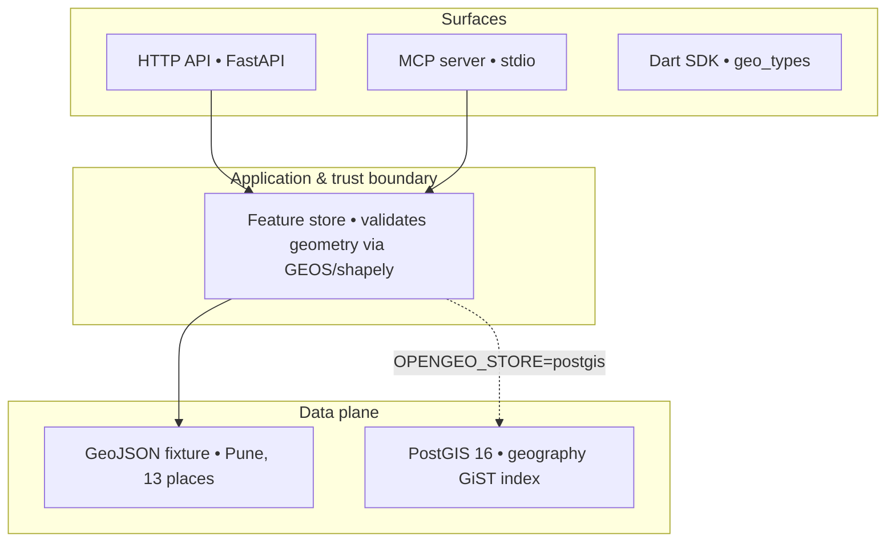

# OpenGeo

[](https://github.com/mr-vishwet/OpenGeo/actions)
[](LICENSE)
[](https://python.org)
[](https://dart.dev)
[](DATA_SOURCES.md)

OpenGeo is a modular, self-hostable geospatial platform: one spatial engine, multiple rendering environments, on-demand geographic data, and modular capabilities for apps, agents and games.

Coordinates are **EPSG:4326, longitude first**. Distances carry an explicit **unit and method**. Bad geometry is rejected with a **stable error code** — never silently repaired. One geography implementation powers every surface (HTTP API, MCP server, Dart SDK), so an answer cannot differ between REST and MCP.

## What OpenGeo does

- **HTTP API** (`opengeo-api`) — place lookup, nearby search, geodesic distance, `contains`/`covers`/`intersects` predicates. Every response carries request id, dataset version, provenance and warnings.
- **MCP server** (`opengeo-mcp`, stdio) — publishes `geo.nearby`, `geo.distance`, `geo.contains`, `geo.intersects` to AI agents. Only what this build can actually serve; routing and geocoding are absent, not stubbed.
- **Dart SDK** (`packages/geo_types`) — `Coordinate`, `Crs`, `BoundingBox`, `Distance`, and seven GeoJSON geometry types with validation. No renderer, database or HTTP dependency.
- **Ingestion gate** (`opengeo-ingest`) — checksum-verified extracts, import runs, atomic publication with rollback, refusal above a 20 % rejection ratio.



## Quickstart

### Run the API

```bash
python -m venv .venv
.venv/Scripts/activate        # Windows
pip install -e ".[dev]"

opengeo-api                   # http://127.0.0.1:8080
```

Interactive schema: <http://127.0.0.1:8080/docs>

### Nearby search around Pune

```bash
curl -s -X POST http://127.0.0.1:8080/v1/nearby \
  -H 'content-type: application/json' \
  -d '{
    "center": {"longitude": 73.8794, "latitude": 18.5158},
    "radius": {"value": 2, "unit": "km"},
    "categories": ["cafe"],
    "limit": 5
  }'
```

### Dart SDK

```bash
cd packages/geo_types
dart pub get
dart test
dart analyze
```

### MCP server (for AI agents)

```bash
opengeo-mcp        # stdio transport; publishes exactly 4 spatial tools
```

### Serve a real database (PostGIS)

```bash
cp .env.example .env            # set POSTGRES_PASSWORD
docker compose -f infrastructure/compose.dev.yml --env-file .env up -d

OPENGEO_STORE=postgis \
OPENGEO_DATABASE_URL=postgresql://opengeo:<password>@localhost:5432/opengeo \
opengeo-api
```

### Import a real extract

```bash
opengeo-ingest --source data/raw/pune.osm.geojson --sha256 <hex> --json
```

The gate validates every feature through the API's trust boundary and refuses when more than 20 % of records fail. Nothing is repaired silently.

## Tests

```bash
pytest                                   # Python suite
cd packages/geo_types && dart test       # Dart suite
ruff check src tests                     # lint
dart analyze                             # Dart analyzer
```

## Use cases

| | | | |
|---|---|---|---|
| <br>**1. Nearby POI search**<br>“What cafés are within 2 km of Shivajinagar?” | <br>**2. Straight-line distance**<br>“How far is Cafe Goodluck from Pune Junction?” | <br>**3. Point-in-region check**<br>“Is this address inside the Pune municipal boundary?” | <br>**4. Line-region intersection**<br>“Does this delivery route cross the restricted zone?” |
| <br>**5. Dataset versioning**<br>“Serve the Pune extract from 14 Nov; roll back if bad.” | <br>**6. Boundary-in vs boundary-on**<br>“`contains` excludes the edge; `covers` includes it.” | <br>**7. Multi-region rollout**<br>“Pune first, then Bengaluru — one active version per region.” | <br>**8. Agent tool access**<br>“MCP server lets an AI agent call `geo.nearby` over stdio.” |
| <br>**9. Extract ingestion gate**<br>“Reject an OSM extract if >20 % of features fail validation.” | <br>**10. Stable error codes**<br>“`invalid_ring` vs `self_intersecting_ring` — branch on code, not message.” | <br>**11. Capability manifest**<br>“`GET /v1/capabilities` tells a client what this deployment refuses.” | <br>**12. Latency baseline**<br>“`benchmarks/run_baseline.py` records p50/p95/p99 with commit + hardware.” |
| <br>**13. Cross-surface parity**<br>“Python and Dart judge the same 29 geometry vectors identically.” | <br>**14. PostGIS authority**<br>“Serve from PostGIS via `OPENGEO_STORE=postgis`; GiST index on geography.” | <br>**15. Atomic publication**<br>“`publish_dataset_version()` flips the active version in one transaction.” | <br>**16. Indian metros roadmap**<br>“Pune → Bengaluru → other metros (ADR-0010, Pune first).” |

Drop your 16 reference screenshots into `docs/images/usecase-01.png` … `usecase-16.png` and they render here automatically.

## License

Code: **Apache-2.0**. OSM-derived data stays under ODbL and remains separate from the code; attribution stays visible in every client.
