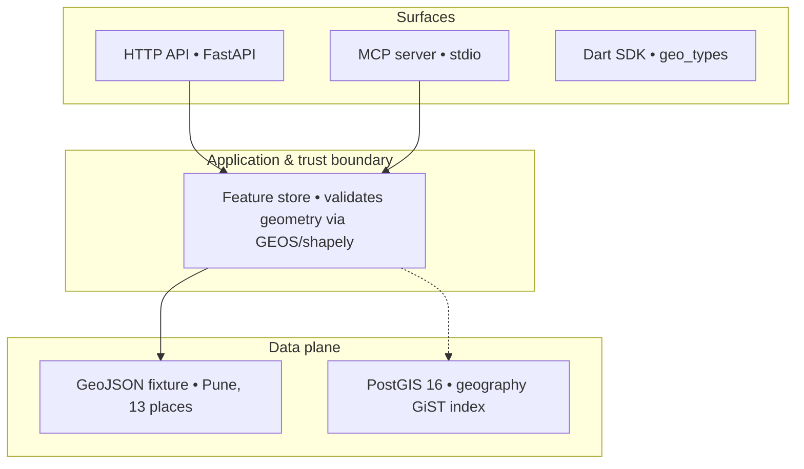

# OpenGeo


A modular, self-hostable geospatial platform: one spatial engine, multiple rendering environments, on-demand geographic data, and modular capabilities for apps, agents and games.

Coordinates are EPSG:4326, longitude first. Distances carry an explicit unit and method. Bad geometry is rejected with a stable error code — never silently repaired. One geography implementation powers every surface (HTTP API, MCP server, Dart SDK), so an answer cannot differ between REST and MCP.

## Use cases

- Nearby POI search — "What cafés are within 2 km of Shivajinagar?"
- Straight-line distance — "How far is Cafe Goodluck from Pune Junction?"
- Point-in-region check — "Is this address inside the Pune municipal boundary?"
- Line-region intersection — "Does this delivery route cross the restricted zone?"
- Dataset versioning — "Serve the Pune extract from 14 Nov; roll back if bad."
- Boundary-in vs boundary-on — "One rule excludes the edge; the other includes it."
- Multi-region rollout — "Pune first, then Bengaluru — one active version per region."
- Agent tool access — "An AI agent can call spatial tools over stdio."
- Extract ingestion gate — "Reject an OSM extract if more than 20 % of features fail validation."
- Stable error codes — "Branch on the error code, not the message."
- Capability manifest — "The manifest tells a client what this deployment refuses."
- Latency baseline — "Records p50/p95/p99 with commit and hardware context."
- Cross-surface parity — "Python and Dart judge geometry vectors identically."
- PostGIS authority — "Serve from a spatial database with an index on geography."
- Atomic publication — "Flips the active dataset version in one transaction."
- Indian metros roadmap — "Pune first, then Bengaluru and other Indian metros."

## Architecture



## Repository layout

```
src/opengeo/            the single Python distribution
  api/                  FastAPI service: routes, envelope, errors, fixture + PostGIS stores
  geo/                  units, geodesy, validation boundary, predicates
  ingestion/            checksummed manifests, quality gate, atomic publish, PostGIS import
  mcp/                  tool catalogue, plan validator, stdio server
packages/geo_types/     canonical coordinate, CRS, bbox and geometry types (Dart)
tests/                  Python suite plus shared parity vectors
infrastructure/         Compose stack, PostGIS migration, API image
benchmarks/             OpenGeoBench baseline runner
docs/                   public documentation
adr/                    architecture decision records
```

