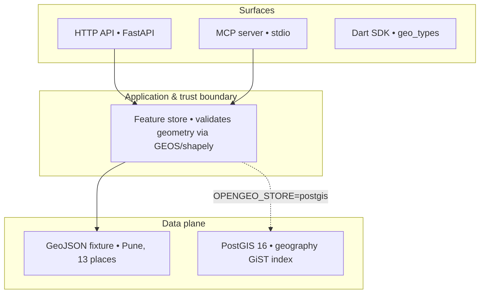

# OpenGeo

[](https://github.com/mr-vishwet/OpenGeo/actions)
[](LICENSE)
[](https://python.org)
[](https://dart.dev)
[](DATA_SOURCES.md)

A modular, self-hostable geospatial platform: one spatial engine, multiple rendering environments, on-demand geographic data, and modular capabilities for apps, agents and games. Coordinates are EPSG:4326, longitude first. Distances carry an explicit unit and method. Bad geometry is rejected with a stable code — never repaired.

## What works today

| Surface | What it does | State |
|---|---|---|
| **HTTP API** (`opengeo-api`) | Capability manifest, dataset metadata, place lookup, nearby search, geodesic distance, `contains`/`covers`/`intersects` predicates. Every response carries request id, dataset version, provenance and warnings. | Live |
| **MCP server** (`opengeo-mcp`, stdio) | Publishes `geo.nearby`, `geo.distance`, `geo.contains`, `geo.intersects` — only what this build can actually serve. Routing, geocoding and isochrones are absent, not stubbed. | Live |
| **Dart SDK** (`packages/geo_types`) | `Coordinate`, `Crs`, `BoundingBox` (antimeridian-aware), `Distance` (unit + method), and the seven GeoJSON geometry types with ring closure, degeneracy, self-intersection and hole-containment validation. No renderer, database or HTTP dependency. | Live |
| **Ingestion gate** (`opengeo-ingest`) | Checksum-verified extracts, import runs with rejection counting, atomic publication with rollback, refusal above a 20 % rejected-record ratio. | Live |
| **PostGIS** | Migration `0001_init.sql` creates the extension, schema and the one-active-version-per-region index. Served via `OPENGEO_STORE=postgis`. | Live on this host |



## Quickstart

### Python API & MCP server

```bash
python -m venv .venv
.venv/Scripts/activate        # Windows
pip install -e ".[dev]"

opengeo-api                   # http://127.0.0.1:8080
opengeo-mcp                   # stdio MCP server
```

Interactive schema: <http://127.0.0.1:8080/docs>

### Check what this deployment can do

```bash
curl -s http://127.0.0.1:8080/v1/capabilities
```

`state` on each capability is the authority — `implemented` means exercised by the test suite; `unavailable` / `requires_external_provider` means refused, not approximated.

### Nearby search

```bash
curl -s -X POST http://127.0.0.1:8080/v1/nearby \
  -H 'content-type: application/json' \
  -d '{
    "center": {"longitude": 73.8794, "latitude": 18.5158},
    "radius": {"value": 2, "unit": "km"},
    "categories": ["cafe"],
    "limit": 5
  }'
```

Distances are metres with a declared method. `distance_m: null` means unknown — never zero.

### Dart SDK

```bash
cd packages/geo_types
dart pub get
dart test
```

## Serve a real database

The reference deployment serves a 13-feature synthetic Pune fixture. To attach PostGIS:

```bash
cp .env.example .env            # set POSTGRES_PASSWORD
docker compose -f infrastructure/compose.dev.yml --env-file .env up -d
```

Then point the API at it:

```bash
OPENGEO_STORE=postgis \
OPENGEO_DATABASE_URL=postgresql://opengeo:<password>@localhost:5432/opengeo \
opengeo-api
```

The migration enforces one active dataset version per region and rejects invalid geometry at insert time. `infrastructure/db/migrations/0001_init.sql` is applied on a fresh volume and smoke-tested in CI.

## Import a real extract

```bash
opengeo-ingest --source data/raw/pune.osm.geojson --sha256 <hex> --json
```

The gate validates every feature through the API's trust boundary, counts rejections by reason, and exits non-zero when more than 20 % of records would be rejected. Nothing is repaired silently.

## Tests & verification

```bash
pytest                                   # Python: 147 tests (+2 skipped without Postgres)
cd packages/geo_types && dart test       # Dart: 79 tests
ruff check src tests                     # lint
dart analyze                             # Dart analyzer
```

Both suites validate `tests/parity/geometry_vectors.json` — hand-written geometry verdicts the Python service and Dart SDK are held to equally. A validation rule that drifts on one surface fails the other.

Run the Postgres smoke test (requires a live database):

```bash
OPENGEO_DATABASE_URL=... pytest tests/test_publication_smoke.py -q
```

## Project state

Phase 1 — the spatial core runs and is tested; the data plane is partially installed.

**Installed:** Git, Dart/Flutter, Python 3.13, Docker Desktop + WSL2, PostGIS 16 (dev stack running on this host).

**Not installed:** regional OSM extract, search engine, geocoder, routing engine, tile stack, authentication, map widget. See `docs/known-limitations.md` for what is deliberately refused and why.

## Repository layout

```
src/opengeo/            the single Python distribution
  api/                  FastAPI service: routes, envelope, errors, fixture + PostGIS stores
  geo/                  units, geodesy, validation boundary, predicates
  ingestion/            checksummed manifests, quality gate, atomic publish, PostGIS import
  mcp/                  tool catalogue, plan validator, stdio server
packages/geo_types/     canonical coordinate, CRS, bbox and geometry types (Dart)
tests/                  Python suite plus shared parity vectors
infrastructure/         Compose stack, PostGIS migration, API image
benchmarks/             OpenGeoBench baseline runner
docs/                   public documentation (contract, limitations, architecture)
adr/                    architecture decision records (0000–0010)
```

## Contributing

A change is done when it has tests, documentation and a defined failure mode. Read the architecture decision records in `adr/` before changing a public contract — coordinate semantics, units, error codes, geometry behaviour and provider behaviour are breaking changes and need an ADR plus a migration note.

```bash
# Python
pip install -e ".[dev]"
pytest
ruff check src tests

# Dart
cd packages/geo_types
dart pub get
dart test
dart analyze
```

See `CONTRIBUTING.md` for commit/PR rules and data rules (OSM-derived data stays ODbL; attribution remains visible in every client).

## License

Code: **Apache-2.0** (`ADR-0009`). OSM-derived data stays under ODbL and remains separate from the code; attribution must stay visible in every client. See `DATA_SOURCES.md` and `THIRD_PARTY_NOTICES.md`.

---
OpenGeo — deterministic geospatial services. One geography implementation, several surfaces that never re-implement it.
